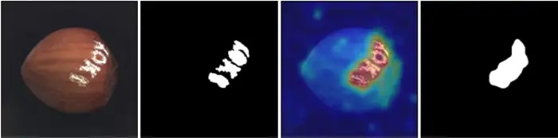

Anomalib makes it relatively easy to train an anomaly detection model on your own images. But once you want to use it in production, you also need to handle inference, evaluate predictions, and keep track of the images that triggered them.

In this tutorial, we'll use anomalib to train and run an anomaly detection model in Python. Then we'll look at how to store images alongside their anomaly scores, so you can review detections and use them for future training.

{/* truncate */}

## Understanding unsupervised anomaly detection

Unsupervised anomaly detection identifies patterns that differ from normal data without requiring examples of every possible defect.

This is particularly useful in manufacturing. You can usually collect thousands of images of good parts, but defective parts are harder to come by. You also can't predict every type of defect that might appear.

Instead of learning specific defects, the model learns what normal looks like and flags anything that differs significantly. Depending on the model and hardware, inference can be fast enough to inspect parts directly on a production line.

## Anomalib, a deep learning library for image anomaly detection

[**anomalib**](https://github.com/open-edge-platform/anomalib) is an open source Python library for training and evaluating anomaly detection models on your own images.

It handles much of the work around data loading, training, evaluation, and model export, so you can focus on choosing and testing a model.



<small>Example of an anomaly detected with anomalib.</small>

Version 2.7.0 requires Python 3.10 or later. Install it with:

```bash
pip install anomalib
```

Before starting, you'll need:

- A few hundred images of defect-free parts for training. This is enough for an initial experiment, although more data may improve results.
- A test set containing some real defects to evaluate how well the model performs.
- Anomaly masks if you want to evaluate where defects are located, rather than just whether an image contains one.

An anomaly mask is an image with the same dimensions as the original, where white pixels mark the defective area and black pixels mark everything else. You can create these manually in an image editor such as GIMP.

Masks are used for evaluation and localization, not for training the unsupervised model. If you only need image-level classification, you can start without them.

### Choosing a model

Anomalib includes several models, and it's worth comparing at least two before settling on one.

**EfficientAd** is a good starting point when inference speed matters, especially on a production line. **Patchcore** is another option that can provide strong detection performance, although it generally requires more memory and computation.

The best choice depends on your images, hardware, and latency requirements. Check the anomalib documentation for the current list of supported models.

## Train a model on your own images in Python

You can train a model using either the command line or the Python API. We'll use Python here because it's easier to integrate into a larger application.

You need three components: a datamodule to load your images, a model to detect anomalies, and an engine to handle training and evaluation.

First, organize your images into two directories:

```
datasets/panel/
├── good/
└── defect/
```

Then configure the `Folder` datamodule and train EfficientAd:

```python
from anomalib.data import Folder
from anomalib.engine import Engine
from anomalib.models import EfficientAd

datamodule = Folder(
    name="panel",
    root="datasets/panel",
    normal_dir="good",
    abnormal_dir="defect",
    train_batch_size=1,
)

model = EfficientAd()
engine = Engine(max_epochs=200)

engine.fit(datamodule=datamodule, model=model)
print(engine.test(datamodule=datamodule, model=model))
```

The `normal_dir` and `abnormal_dir` paths are relative to `root`.

Notice that `train_batch_size` is set to 1. This is required by EfficientAd, rather than a workaround for limited GPU memory. Other models can use larger batches.

You can run the same training from the command line:

```bash
anomalib train --model EfficientAd --data anomalib.data.Folder \
  --data.name panel --data.root datasets/panel \
  --data.normal_dir good --data.abnormal_dir defect \
  --data.train_batch_size 1 --trainer.max_epochs 200
```

Once training finishes, anomalib saves a checkpoint under `results/`.

### Run inference on new images

To test the trained model on a new image, create a `PredictDataset` and load the checkpoint:

```python
from anomalib.data import PredictDataset

dataset = PredictDataset(path="frames/0001.png", image_size=(256, 256))

predictions = engine.predict(
    model=model,
    dataset=dataset,
    ckpt_path="results/EfficientAd/panel/latest/weights/lightning/model.ckpt",
)

for prediction in predictions:
    print(prediction.image_path, prediction.pred_score, prediction.pred_label)
```

Check the checkpoint path in your own `results/` directory, since it depends on the model and dataset names.

Each prediction contains several useful fields:

- `pred_score`: a numerical score indicating how anomalous the image is.
- `pred_label`: the classification after applying a threshold.
- `anomaly_map`: a pixel-level heatmap showing where the model detected anomalies.
- `image_path`: the original image path.

In practice, you'll often use `pred_score` to decide whether a part needs inspection. The anomaly map helps an operator understand which area triggered the detection.

## From training to production with ONNX or OpenVINO

So far, we've been using PyTorch for training and inference. For deployment, you may want to export the model to a runtime better suited to your target hardware.

ONNX provides a portable model format supported by different inference runtimes. OpenVINO is optimized for Intel hardware and is particularly relevant for industrial edge computers.

Anomalib supports exporting trained models directly:

```python
from anomalib.deploy import ExportType

engine.export(model=model, export_type=ExportType.OPENVINO)
```

You can also export from the command line using `anomalib export --export_type OPENVINO` with the appropriate checkpoint.

The resulting model can be loaded using OpenVINO, or ONNX Runtime if you chose ONNX.

If you've used an older anomalib tutorial, you might have seen an `export_mode` setting inside an `optimization` block in `config.yaml`. That was part of the 1.x configuration and doesn't apply to the current version.

### Test the model in shadow mode

Before allowing a new model to affect production, it's useful to run it in shadow mode.

In shadow mode, the model processes live images without affecting production decisions.

Your existing inspection process continues as usual. Meanwhile, the new model scores the same images, and you compare the results afterward.

This lets you measure false positives, missed defects, and inference performance on real production data before relying on the model.

To do that comparison, however, you need to know exactly which frame produced each prediction.

## Keep each anomaly score with its original image

Anomalib gives you the anomaly score and heatmap, but it doesn't manage how you store those results. That's something you need to handle in your application.

One approach is to send anomaly scores to a database or MQTT topic and store the images separately in a filesystem or object store. This works, but you then need a way to match each score back to its original image, usually by filename or timestamp, and that mapping gets harder to keep correct as the system grows.

An alternative is to store the score directly with the image.

### Store images and scores in ReductStore

With ReductStore, you can store each camera frame as a timestamped record and attach the anomaly score as a label.

Here's an example using the Python SDK:

```python
import time
from reduct import Client

async with Client("http://127.0.0.1:8383", api_token="my-token") as client:
    bucket = await client.create_bucket("inspection", exist_ok=True)

    await bucket.write(
        "camera-1",
        frame_jpeg,
        time.time(),
        labels={
            "anomaly_score": prediction.pred_score,
            "anomaly": prediction.pred_label,
            "model": "efficientad-2026-10",
        },
        content_type="image/jpeg",
    )
```



<small>
  A query filters the same records by their anomaly_score label, and a head read
  returns labels while the image payloads stay in the store.
</small>

Each record contains the image, its timestamp, and the labels produced by the model.

Now, instead of retrieving scores and images separately, you can query the records directly.

For example, to retrieve frames with an anomaly score above 0.7 during a specific shift:

```python
async for record in bucket.query(
    "camera-1",
    start=shift_start,
    stop=shift_end,
    when={"&anomaly_score": {"$gt": 0.7}},
):
    image = await record.read_all()
```

The `&` prefix refers to a label stored on the record, while `$gt` means greater than.

The condition is evaluated within the specified `start` and `stop` window. It's worth providing a time range even when it's optional, since otherwise the query may need to examine every record in the entry.

You can also use the `head` parameter to retrieve only the metadata and labels, without downloading the image payloads.

This is useful when you want to analyze anomaly scores over several hours or days without transferring all the camera images.

### Reviewing anomalies and preparing new training data

You can also use these records to review false positives and prepare new training datasets.

For example, an operator can retrieve all frames flagged during the previous shift, inspect them, and mark false positives. Those corrections can be stored as additional labels on the same records.

When you prepare the next training dataset, you can query the same data again to find relevant images.

You can also store the model version as a label. This makes it easier to identify which model produced a prediction and compare results from different deployments.

For shadow-mode testing, you can retain the outputs from both the existing process and the new model, then compare them against the same recorded frames.

### Why time-indexed storage helps

A time series database works well for numerical values such as anomaly scores, but storing large image payloads alongside them is often less practical.

Object storage handles images well, but querying those objects by timestamp and anomaly score typically requires additional indexing.

With time-indexed storage, the image and its metadata can be queried together.

In this example, each camera has its own entry, and records are indexed by timestamp. You can retrieve frames from a particular time window, filter them using their labels, or read only the metadata.

One thing to keep in mind is that timestamps don't automatically synchronize different cameras. If you need millisecond-level alignment between devices, you still need synchronized clocks.

## Storing images, annotations, and models at the edge

For a production line, running anomaly detection close to the camera can also reduce network traffic.

Instead of continuously sending every image to a central server, you can process frames locally, retain recent recordings, and transfer only the data needed for inspection or further analysis.

ReductStore's retention policies can automatically remove older records when storage limits are reached.

You can also use separate entries to store related data. For example, manually reviewed annotations and segmentation masks can be stored with the timestamp of the original frame.

This lets you keep the original recording unchanged while adding information from later reviews.

The same applies to model files. You can store model versions in a bucket and use the model label on each prediction to identify which version was running at the time.

This lets you investigate older detections using the model version that originally produced them.

## Further reading

For details about filtering records by labels, see the ReductStore [**conditional query reference**](/docs/conditional-query). The [**data querying guide**](/docs/guides/data-querying) explains time ranges, the `when` parameter, and metadata-only reads using `head`.

If you're recording at camera frame rate, the [**data ingestion guide**](/docs/guides/data-ingestion) also covers batch writes.

For robotics applications, the [**ROS image storage tutorial**](/blog/tutorials/ros/optimal-image-storage-solutions-for-ros-based-computer-vision) shows how to record image topics with their original timestamps.

You can also explore the [**computer vision applications overview**](/blog/computer-vision-applications) or the [**open source alternatives to Landing AI**](/blog/computer-vision/ai/mlops/opensource/open-source-alternatives-to-landing-ai) comparison if you're deciding between building your own anomaly detection pipeline and using an existing platform.
